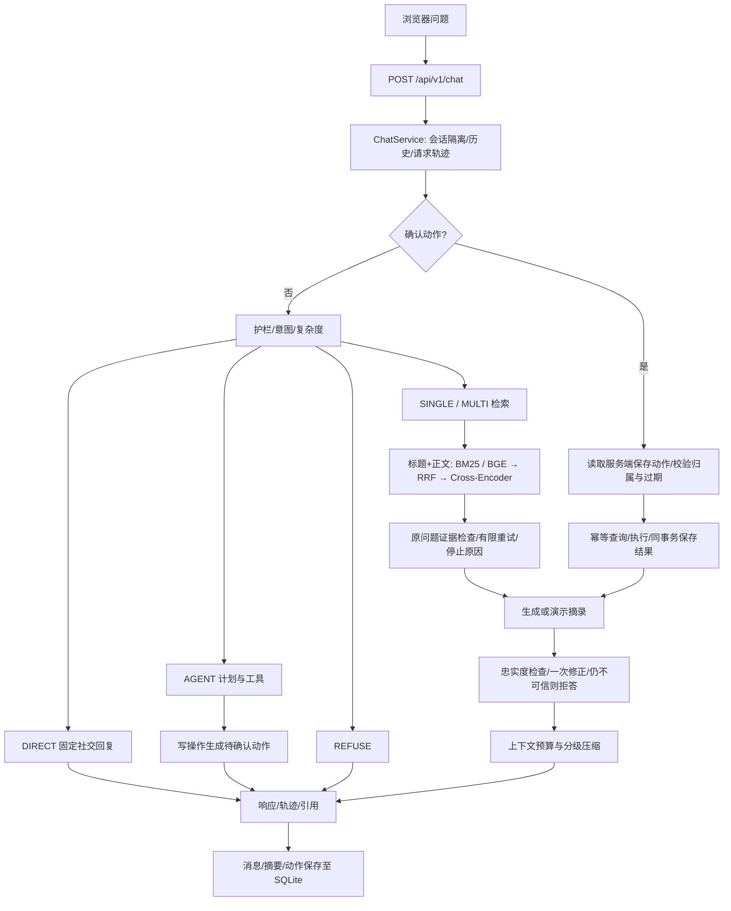

# 架构与真实数据流

项目保留原有 FastAPI → ChatService → LangGraph 分层。浏览器是本次新增的同源静态界面，没有独立前端平台，也没有第二套客服实现。

模块职责：

| 模块 | 职责与关键入口 |
|---|---|
| app/main.py / api | 应用生命周期、同源静态界面、聊天、状态、来源查询、错误响应 |
| services/container.py | 组装 SQLite、可选 Redis/Qdrant、模型、检索、工具 |
| services/chat_service.py | 用户会话归属、追问消歧、确认事务、响应统计；SSE 完成检查后输出 |
| agents/graph.py / nodes | 护栏、分类、路由、检索、计划、执行、回答、校验、压缩 |
| retrieval | 解析清洗、相对路径文档 ID、分块、标题索引、中文 BM25、RRF、重排与 Self-RAG |
| providers | DeepSeek API、本地 BGE、真实 CrossEncoder；显式 Hash/词面/演示后备 |
| repositories | ORM、业务模拟数据、消息摘要、幂等与待确认动作 |
| memory | 启发式 token 估计、工具截断、历史窗口、自动摘要；工具结果也计入预算 |
| observability | ContextVar 请求轨迹、逻辑模型调用、HTTP 尝试次数、usage、JSON 日志和指标 |
| eval/compare.py | 独立比较检索与证据检查，不启动聊天服务，不宣称生成正确率 |

一次复合政策请求先解析意图，没有订单实体且没有明确交易动作时走政策路径。MULTI 每轮保留原问题、执行改写与补充查询，按 chunk_id 累积去重。每轮检查最终保留的证据，充分就停；裁判故障明确停止；不足最多 max_retrieval_hops 轮。原始输入、补足上下文后的问题、各轮查询与证据分别记录。生成和忠实度检查使用带 ID 的同一批证据。

引用从实际回答选定的 chunk_id 生成，只允许当前证据中的 ID。模型答案检查只使用其引用的证据；改写后重新匹配引用，不沿用旧列表。演示模式整段摘录，回答、引用 excerpt 与来源接口可逐字核对；这是结构性的原文输出，并非通过真实模型裁判。

确认由数据库中的 action_id 绑定用户、会话、工具与参数。当前确认消息不能替换操作参数。执行、幂等记录与结果保存同事务提交；相同会话在一个进程内串行，重复确认返回保存结果且本次调用统计清零。多进程部署需要数据库锁/唯一业务约束，当前基础版不支持。

统计中的 llm_calls 是实际发生的 provider.generate 逻辑调用，演示 provider 也会被标明。network_attempts 是实际模型 HTTP 尝试，包含重试。总 usage 汇集分类、改写、裁判、生成与摘要，来自 API 返回值；本地模型调用另记 backend_calls。llm_ms 是这些逻辑调用耗时之和；retrieval_ms 包含改写/重排/裁判，所以阶段时间存在重叠，不能直接相加。

MCP 的本地营业时间、仓库截单演示工具和 HTTP 适配器保留。默认示例关闭 MCP；启用本地入口只返回模拟数据。远程入口需主动提供 MCP_REMOTE_URL，本轮没有连接外部系统。
